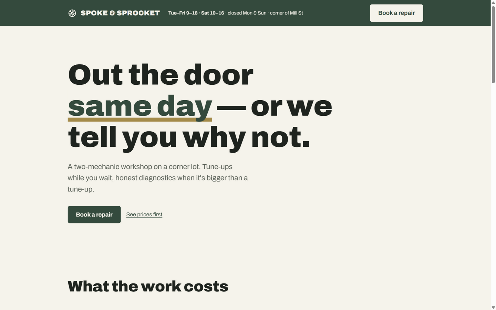
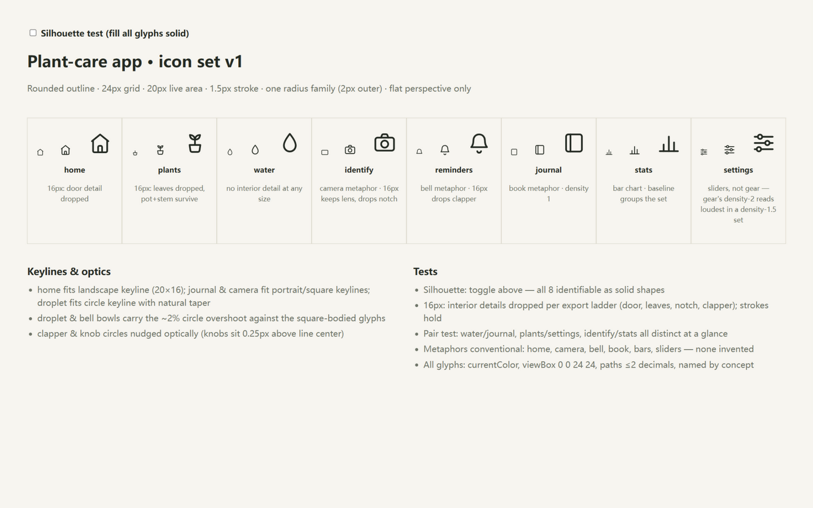

# 🌱 design-garden

English | [简体中文](README.zh-CN.md) | [繁體中文](README.zh-TW.md) | **日本語** | [한국어](README.ko.md) | [Español](README.es.md) | [Português](README.pt-BR.md) | [Français](README.fr.md) | [Deutsch](README.de.md) | [Русский](README.ru.md)

**成長するデザインスキル。** AI コーディングエージェントのための、自己改善するユニバーサルデザインスキル — UI、ポスター、バナー、アイコン、ロゴ、ブランド、スライド、データビジュアライゼーション、動画・モーション、イラスト、タイポグラフィ、デザインレビューまで、美しさに関わるすべてをカバーします。


> 🌻 **AIツールが初めての方へ** — コード不要でインストール・使用・貢献までできます：**[初心者ガイド（中文）](docs/start-here.zh-CN.md)** · English: [Start Here](docs/start-here.md)

ほとんどのエージェント用「デザインスキル」は凍結されたプロンプト集です：初日は強力でも、三十日後には陳腐化し、しかも常に作者一人のセンスのまま。**design-garden は「育てられる」ために設計されています** — あなたの日々のデザイン作業と、コミュニティによって。このスキルはデザインタスクを実行するだけでなく、**実行したすべてのタスクから学習します**。

## これが作れる

以下はすべて、skill が自分自身の評価タスクを実行して生み出した実物です — 各作品は完全なワークフロー（クリティークゲート込み）を通過しています。詳細は [examples/](examples/README.md)（ゲートが捕まえた問題リスト付き）。

| | | |
|---|---|---|
|  |  |  |
| ランディングページ（[モバイル 375px](examples/images/bike-shop-mobile.png)） | 開店ポスター 1080×1350 | アイコンセット、16/24/48 エクスポート |

*生成モデル：**GLM-5.3-Flash** — 各サンプルのモデル帰属は [examples/README.md](examples/README.md) を参照。*

## なぜ違うのか：4 つの成長ループ

1. **① ランタイム自己学習** — タスクのたびに構造化された学習エントリを `learnings/<domain>.md` に追記。再インストール不要で、使うほどあなた専用に強くなります
2. **② コミュニティ貢献** — 知識 = 小さなモジュールファイル。1 PR = 1 スタイルレシピ / 技法 / ケーススタディ
3. **③ 評価ゲート付き昇格（膨張防止）** — 新知識は `experimental` として着地し、明示的な一致時のみロード。ブラインド A/B 評価に勝って `proven` へ昇格
4. **④ バージョン化された学習** — 各リリースの CHANGELOG には「このバージョンで何を学んだか」を記録。成長が読める

```
 ① 各タスク → learnings/ に経験を蓄積
        ↓（一般化できるエントリは上流へ PR）
 ② コミュニティ PR が knowledge/ に追加
        ↓（新知識は experimental）
 ③ ブラインド A/B で勝利 → proven に昇格
        ↓
 ④ CHANGELOG が「学んだこと」を記録
```

## 中身

```
SKILL.md                  ルーター + 8 ステップのワークフロー（≤500 行 — 安定した核）
knowledge/
  core/                   汎用モジュール：原則 · 色 · タイポグラフィ · レイアウト · モーション · anti-slop
  domains/                9 ドメイン：ui-web · ui-mobile · ポスター/バナー · アイコン · ロゴ/ブランド ·
                          スライド · データビズ · 動画/モーション · イラスト（各クリティークチェックリスト付き）
  styles/                 18 スタイルレシピ（スイス、バウハウス、ネオ・ブルータリズム、グラスモーフィズム、
                          ダークテック、Y2K、ジャパンディ、メンフィス…）— 各 1 ファイル
  case-studies/           ビフォー/アフターとその推理
learnings/                スキルのフィールドノート — 実行のたびに育つ
evals/                    意図的な罠入りベンチマーク + ルーブリック + ブラインド A/B ツール
scripts/                  validate_knowledge.mjs（CI ゲート）· ab_harness.mjs（ブラインド評価ページ）
```

ルーターは `knowledge/INDEX.md` を読み、タスクごとに**約 7 ファイルまで**しかロードしません — **膨らまずに育つ**。ワークフロー自体が、エージェントデザイン実践の最強のプロセス思想の蒸留です：**3 方向ディーリング**、**形式の 5 問**、各ラウンドで最も被害の大きい 3 問題だけを修する**クリティークゲート**、そして 3 ソースが独立に収束した **anti-slop リスト**。詳細は [SOURCES.md](SOURCES.md)。

## インストール

SKILL.md 規約をサポートするあらゆるエージェントで動作します（ZCode、Claude Code など）：

```bash
# ユーザーレベル（全プロジェクト）
git clone https://github.com/iifzx/design-garden.git ~/.agents/skills/design-garden

# またはプロジェクトレベル
git clone https://github.com/iifzx/design-garden.git <project>/.zcode/skills/design-garden
```

ビルド不要・依存ゼロ — markdown とオプションの Node スクリプト（標準ライブラリのみ）。全ページのスクリーンショットには Playwright があると便利です（任意）。

## 使い方

ただデザインを頼むだけ。美的なものであれば何でもトリガーします：

- 「近所のパン屋のオープンポスターを作って」→ 3 つのアートディレクションをディールし、最強のものを実行、クリティーク、成果物、学習の記録
- 「植物ケアアプリのアイコンセットをデザインして」→ キーライングリッド、光学的補正、シルエットテスト
- 「このポスター変だよね — どこが問題？」→ レビュー優先モード、ドメインチェックリスト、被害順の修正提案
- 「ランディングページ + スライドテンプレ一式」→ 両ドメインをルーティング、両方から学習

## 貢献する

**庭は小さな PR で育ちます。** スタイルレシピの追加、自分の使用から学習の報告、評価の実施による experimental ルールの昇格。すべては [CONTRIBUTING.md](CONTRIBUTING.md) に — 要約：Fork し、スキーマに従って**小さなファイルを 1 つ**追加、`node scripts/validate_knowledge.mjs` が通ること（CI が強制）、PR を出す。コミュニティ知識は `experimental` で始まり、ブラインド A/B 評価に勝つと `proven` に — 成長は**検証済み**です。

## 多言語

英語が一次バージョンです（知識ファイルとトリガー語彙はモデルの安定性のため英語を維持）。翻訳：

- 简体中文: [README.zh-CN.md](README.zh-CN.md) · 繁體中文: [README.zh-TW.md](README.zh-TW.md)
- 日本語: [README.ja.md](README.ja.md)（このファイル）· 한국어: [README.ko.md](README.ko.md)
- Español: [README.es.md](README.es.md) · Português: [README.pt-BR.md](README.pt-BR.md)
- Français: [README.fr.md](README.fr.md) · Deutsch: [README.de.md](README.de.md) · Русский: [README.ru.md](README.ru.md)

言語を追加するには [CONTRIBUTING.md](CONTRIBUTING.md) の "Translations" セクションを参照。

## ライセンス & クレジット

MIT — [LICENSE](LICENSE) を参照。17 のデザインスキルとデザイン業界の共有クラフトから蒸留して播種されました。クレジット一覧は [SOURCES.md](SOURCES.md)。

🌱 *庭の価値は、何を育てたかで決まる。*
