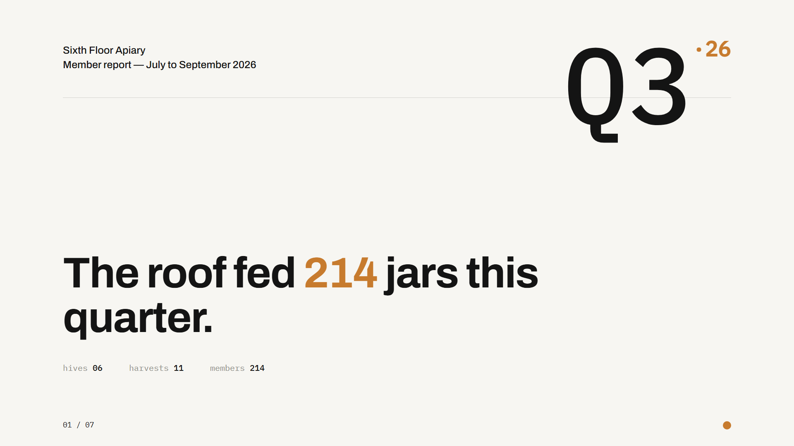
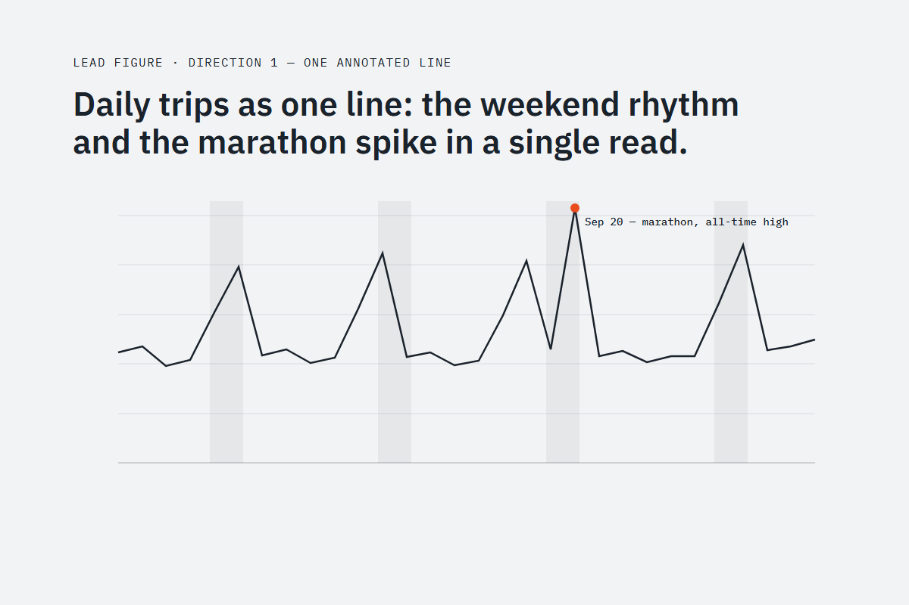
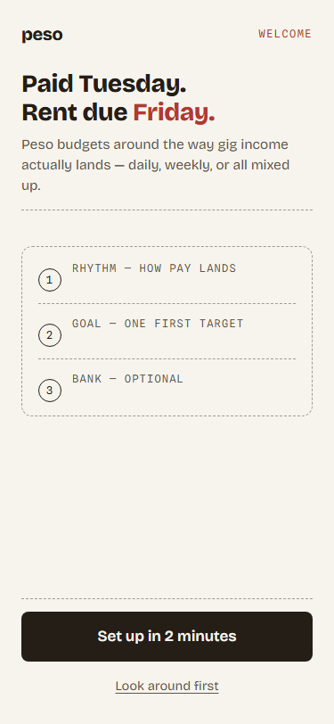
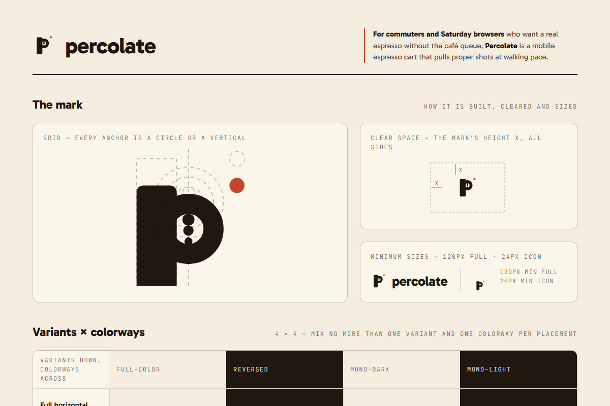
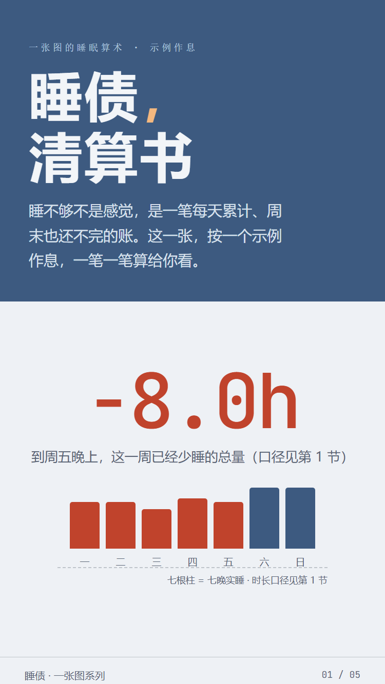
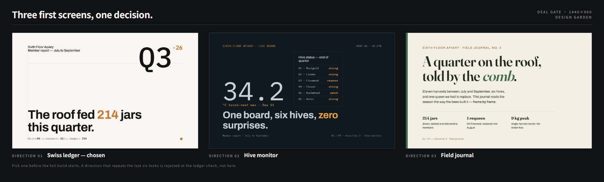
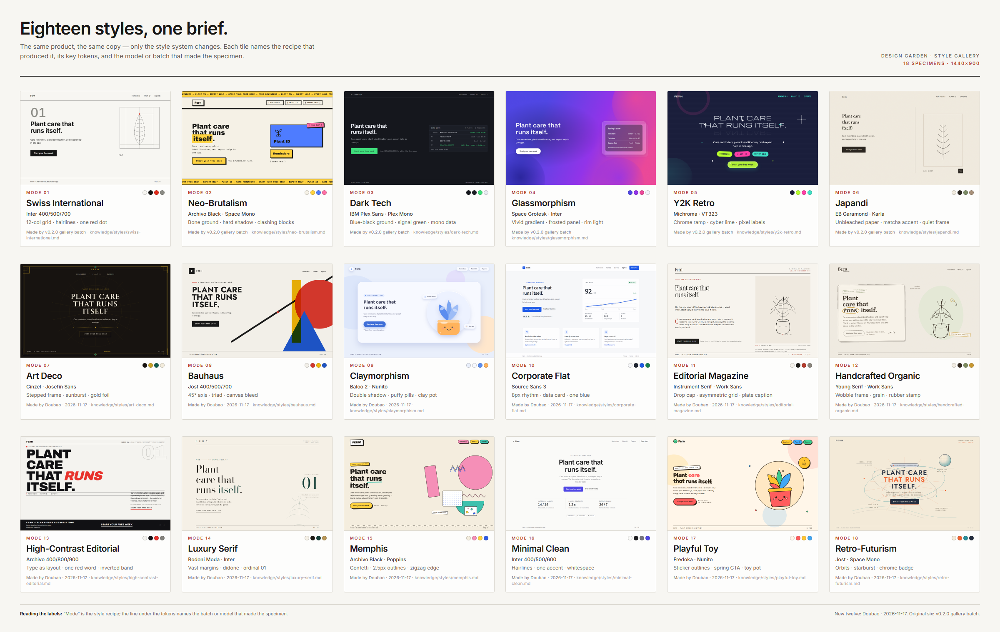
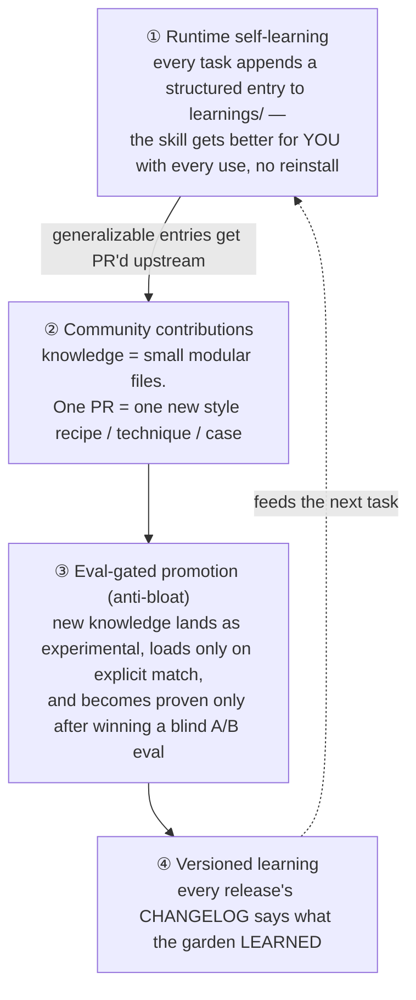

<sub>🌐 English · **[简体中文](README.zh-CN.md)** · [繁體中文](README.zh-TW.md) · [日本語](README.ja.md) · [한국어](README.ko.md) · [Español](README.es.md) · [Português](README.pt-BR.md) · [Français](README.fr.md) · [Deutsch](README.de.md) · [Русский](README.ru.md)</sub>

<div align="center">
  

  # 🌱 design-garden

  > *Plant a design skill. Watch it grow.*
  > *「种下一个设计技能，然后看着它长大。」*

  [](LICENSE)
  [](https://github.com/iifzx/design-garden/stargazers)
  
  
  
  

  **A universal, self-improving design skill for AI coding agents** — covering anything aesthetic: UI, posters, banners, icons, logos, brand identity, slides, data visualization, video & motion, illustration, typography, and design critique.

  [▶ 60-second demo](https://iifzx.github.io/design-garden/demo/) · [Knowledge base](https://iifzx.github.io/design-garden/) · [What it makes](#what-it-makes) · [Why it's different](#why-its-different) · [What's inside](#whats-inside) · [Install](#install) · [Contribute](#for-contributors)
</div>

> 🌱 **New to AI tools?** No-code install, plain-language usage, and zero-skill ways to help: **[Start Here](docs/start-here.md)** (中文：[新手指南](docs/start-here.zh-CN.md)) — and the [beginner site](https://iifzx.github.io/design-garden/start/) explains every GitHub button, no code needed.

## What it makes

**The portfolio — 10 works across 9 craft domains.** Every piece was made by the skill running its own workflow: a three-direction DEAL before the build (evidence kept), `lint.mjs` + rendered GATE before delivery, and a learning note written back afterwards. Each work below is labeled with its domain, format, and the model that produced it.

| | | |
|---|---|---|
|  |  |  |
| **Landing page** · ui-web · 1440 + 375<br>**GLM-5.3-Flash** · [source](examples/bike-shop-landing/landing.html) · [mobile](examples/images/bike-shop-mobile.png) · [full page](examples/images/bike-shop-full.png) | **Member-report deck** · slides · 7 × 1920×1080<br>**GLM-5.3-Flash** · [overview wall](examples/apiary-quarterly-deck/index.html) · [harvest chart](examples/images/deck-03-harvest.png) · [varroa chart](examples/images/deck-05-varroa.png) | **Rider report** · data-viz · 1200px data page<br>**GLM-5.3-Flash** · [source](examples/bike-share-report/report.html) · [full render](examples/images/bike-report-full.png) |
|  |  |  |
| **Opening-night poster** · poster-banner · 1080×1350<br>**GLM-5.3-Flash** · [source](examples/jazz-cafe-poster/late-set-1080x1350.html) · [direction 2](examples/images/jazz-poster-cut-record.png) | **Night-run carousel** · social-carousel · 7 × 1080×1440, 中文<br>**GLM-5.3-Flash** · [source](examples/night-run-carousel/carousel.html) · [route page](examples/images/night-run-03.png) · [closing CTA](examples/images/night-run-07.png) | **Plant-care icon set** · icon · 8 glyphs, 16/24/48 ladder<br>**GLM-5.3-Flash** · [source](examples/plant-icons/icon-sheet.html) · [SVGs](examples/plant-icons/svg/) |
|  |  |  |
| **Onboarding prototype** · ui-mobile · tap-through, 6 states, 375×812<br>**GLM-5.3-Flash** · [source](examples/peso-onboarding/onboarding.html) · [failed state](examples/images/peso-connect-failed.png) · [empty home](examples/images/peso-home-empty.png) · [landscape](examples/images/peso-landscape.png) | **Logo system + guide** · logo-brand · 4 variants × 4 colorways<br>**GLM-5.3-Flash** · [board](examples/percolate-brand/brand-guide.html) · [full board](examples/images/percolate-guide-full.png) · [DEAL sheet](examples/percolate-brand/deal/deal-sheet.png) | **Sleep-debt longform** · infographic-long · 750×9054, 中文<br>**GLM-5.3-Flash** · [source](examples/sleep-debt-infographic/infographic.html) · [week bars](examples/images/sleep-bars.png) · [cumulative](examples/images/sleep-curve.png) |

<p align="center">
  
</p>
<p align="center"><sub>▲ <b>The DEAL gate as a picture</b> — three structurally different first screens built and compared before the deck; the report dealt its lead figure and the carousel its cover the same way. Evidence and the gate's caught-and-fixed list: <a href="examples/README.md">examples/README.md</a>.</sub></p>

**▶ [Watch the 60-second loop](https://iifzx.github.io/design-garden/demo/)** — one real run narrated start to finish: the brief, the three-direction deal, the gate's actual RED catches (CTA hover at 3.3:1, nav at 2.6:1, an 11.5px label), the fixes, and the learning note written back. Every frame is a file from this repo. Or open [demo/demo.html](demo/demo.html) from a clone.

### One brief, eighteen styles — the style gallery

<p align="center">
  
</p>
<p align="center"><sub>▲ <b>18 style specimens on one brief</b> — same copy, same layout skeleton, 18 different skins. Every image in this README was made by the skill itself. <a href="examples/styles/">Browse the specimens</a></sub></p>

The stills are real outputs — every piece went through the full workflow, critique gate included. *Generated with **GLM-5.3-Flash** — per-example model attribution in [examples/README.md](examples/README.md). Run the same brief on another model and PR your result.*

Most agent "design skills" are frozen prompt packs: strong on day one, stale on day thirty, and always one author's taste. **design-garden is built to be fed** — by your daily design work, and by the community. It doesn't just execute design tasks; it *learns from every task it runs*.

---

## Why it's different

| | **design-garden** | Frozen prompt packs | Single-domain skills |
|---|---|---|---|
| Coverage | All 9 design domains + 18 styles | Varies | One domain, deep |
| Growth | Learns from every task + community PRs | Never changes | Manual forks |
| Quality control | Eval-gated promotion + CI injection scan | None | Rarely |
| Beginner paths | Designed-in (vote, report, translate) | None | None |
| Bloat control | ≤6 files loaded per task, line budgets | Grows forever | N/A |

### The four growth loops



## What's inside

```
SKILL.md                  router + 8-step workflow (≤500 lines — the stable core)
knowledge/
  core/                   universal modules: principles · color · typography · layout · motion · anti-slop
  domains/                9 domains: ui-web · ui-mobile · poster-banner · icon · logo-brand · slides · data-viz · video-motion · illustration-art
  styles/                 18 style recipes (swiss, bauhaus, neo-brutalism, glassmorphism, dark-tech, y2k, japandi, memphis…) — one small file each
  case-studies/           before/after with reasoning
learnings/                the skill's field notes — starts seeded, grows with every task
evals/                    benchmark briefs with deliberate traps + rubric + blind A/B harness
scripts/                  validate_knowledge.mjs (CI gate) · ab_harness.mjs (blind eval pages)
                          shoot.mjs · lint.mjs · ledger.mjs · directions.mjs (delivery tools)
                          gallery.mjs (18-style gallery builder, repo maintenance)
```

Every knowledge file carries frontmatter (`id / kind / applies / status / source / updated`). `experimental` knowledge loads only on explicit match; `proven` loads by default. The router reads `knowledge/INDEX.md` and never loads more than ~6 files per task — **growing without bloating**.

Four delivery tools ship in `scripts/`: `shoot.mjs` renders at exact sizes and builds a contact sheet, `lint.mjs` runs the mechanical half of the GATE (contrast, floors, `transition: all`, motion escapes, the Never list), `ledger.mjs` remembers the look of your last deliveries so the next one does not repeat it, and `directions.mjs` renders 2–3 real 1440×900 first screens and composes the DEAL sheet. None of them blocks: Playwright is used when installed, a local Chrome/Edge over the DevTools Protocol otherwise, and when neither exists the script exits 2 and says what it could not verify. `gallery.mjs` is repo maintenance — it re-renders the 18 style specimens and writes `examples/styles/index.html` + `overview.png`.

The workflow itself is a distillation of the strongest process ideas in agent design practice: a **three-direction deal** (2–3 structurally distinct art directions, each shown as a real 1440×900 first screen before the full build), the **five form questions**, a **critique gate** that fixes only the 3 most damaging issues per round, and a canonical **anti-slop list** merged from three independently-convergent sources. See [SOURCES.md](SOURCES.md).

## Install

**One command, 20+ agents.** The [skills CLI](https://skills.sh) (the open agent-skills registry) installs design-garden into Claude Code, Codex, Cursor, Windsurf, Gemini CLI, OpenCode, ZCode and other SKILL.md loaders — it detects which agents you have and offers them as a picker:

```bash
npx skills add iifzx/design-garden      # pick your agent interactively
npx skills add iifzx/design-garden -g   # user-level, all projects
```

Other routes, same destination:

```bash
# plugin marketplace (Claude Code)
/plugin marketplace add iifzx/design-garden
/plugin install design-garden@design-garden

# via npm/github (cross-platform installer)
npm i -g github:iifzx/design-garden && design-garden

# classic git clone (user-level, all projects)
git clone https://github.com/iifzx/design-garden.git ~/.agents/skills/design-garden

# DeepSeek Harness (dsh) — skill roots are non-recursive, so clone to a skill root
git clone https://github.com/iifzx/design-garden.git ~/.dsh/skills/design-garden

# or project-level
git clone https://github.com/iifzx/design-garden.git <your-project>/.zcode/skills/design-garden
```

Every route serves the same vetted tree: CI runs the knowledge validator and an injection scan on every commit, and community knowledge stays `experimental` (loads only on explicit match) until it wins a blind A/B eval — the install never contains unreviewed load-by-default rules.

DeepSeek Harness note: dsh reads the same Agent Skills standard (SKILL.md dirs, non-recursive discovery under `~/.dsh/skills` or `~/.agents/skills`). The skill declares `whenToUse` for dsh's trigger metadata.

> ZCode desktop: **Plugin Marketplace → Add → paste `https://github.com/iifzx/design-garden`**. The marketplace layout follows the Claude Code plugin convention; if your CLI's loader expects different nesting, the git-clone path always works — report it as an issue so we can support your loader too.

No build step. The scripts are Node with stdlib only; `shoot.mjs` gets full-page and per-screen support from Playwright when it is installed, and otherwise drives a local Chrome/Edge over the DevTools Protocol. Nothing is required beyond Node.

## Use it

Just design. The skill triggers on anything aesthetic:

- "Make a landing page for my ceramics studio" → deals 3 art directions, executes the strongest, critiques, delivers, records what it learned
- "Design an icon set for a plant-care app" → keyline grids, optical corrections, silhouette tests
- "This poster looks off — review it" → critique-first mode, runs the domain checklist, gives fixes ranked by damage
- "品牌海报 + 一套 PPT 模板" → routes both domains, learns both

Before a multi-canvas build, `directions.mjs` turns 2–3 directions into one labeled first-screen sheet; after delivery, the three tools close the loop: `shoot.mjs` shows the page at 1440 and 375, `lint.mjs` lists floor violations with line numbers, `ledger.mjs add` records the look so the next project starts somewhere else.

## For contributors

**The garden grows on small PRs.** Add a style recipe (~1 hour), report a learning from your own use (minutes), or run an eval to promote an experimental rule to proven. Everything is in [CONTRIBUTING.md](CONTRIBUTING.md) — the short version:

1. Fork, add **one small file** following the schema (or one learning entry)
2. `node scripts/validate_knowledge.mjs` must pass (CI enforces it)
3. Open the PR — CHANGELOG will say "the garden learned X"

Community knowledge starts `experimental` (loads only on explicit match) and becomes `proven` by winning a blind A/B eval — so growth is *verified*, not just accumulated.

---

## Translations

English is the primary version — the skill content (SKILL.md, knowledge files) and trigger vocabulary stay English for model reliability. Community translations of the README live alongside it:

- 简体中文: [README.zh-CN.md](README.zh-CN.md) · 繁體中文: [README.zh-TW.md](README.zh-TW.md)
- 日本語: [README.ja.md](README.ja.md) · 한국어: [README.ko.md](README.ko.md)
- Español: [README.es.md](README.es.md) · Português: [README.pt-BR.md](README.pt-BR.md)
- Français: [README.fr.md](README.fr.md) · Deutsch: [README.de.md](README.de.md) · Русский: [README.ru.md](README.ru.md)

The v0.1.5 translations were drafted by GLM-5.3-Flash — improvements from native speakers are very welcome (see [CONTRIBUTING.md](CONTRIBUTING.md#translations)).

## Contributors

This garden lives on contributions, recognized via [all-contributors](https://allcontributors.org) (`.all-contributorsrc`):

<!-- all-contributors table start -->
|                                                                                                            |
|------------------------------------------------------------------------------------------------------------|
| [@iifzx](https://github.com/iifzx) 💼 📖 🎨 🚧 🌍 — code, docs, design, maintenance, translations |
<!-- all-contributors table end -->

Feed it and add yourself: comment `@all-contributors please add @<you> for <contributions>` on any issue, or PR the table above.

## Star history

[](https://star-history.com/#iifzx/design-garden)

## License & credits

MIT — see [LICENSE](LICENSE). Seeded by distilling 17 design skills and the shared craft canon; full credit in [SOURCES.md](SOURCES.md).

🌱 *Gardens are judged by what they grow.*
