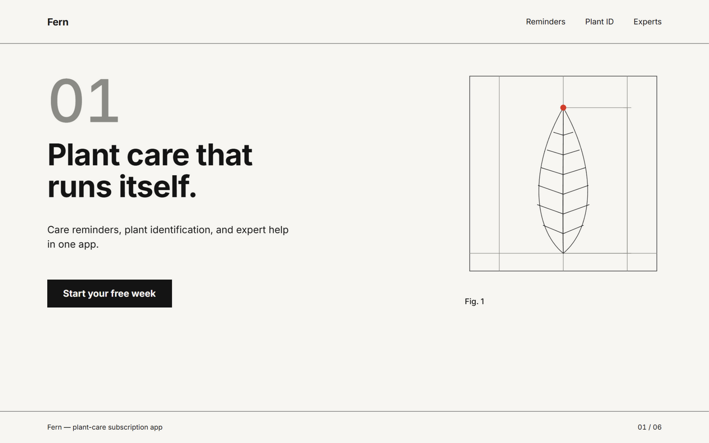
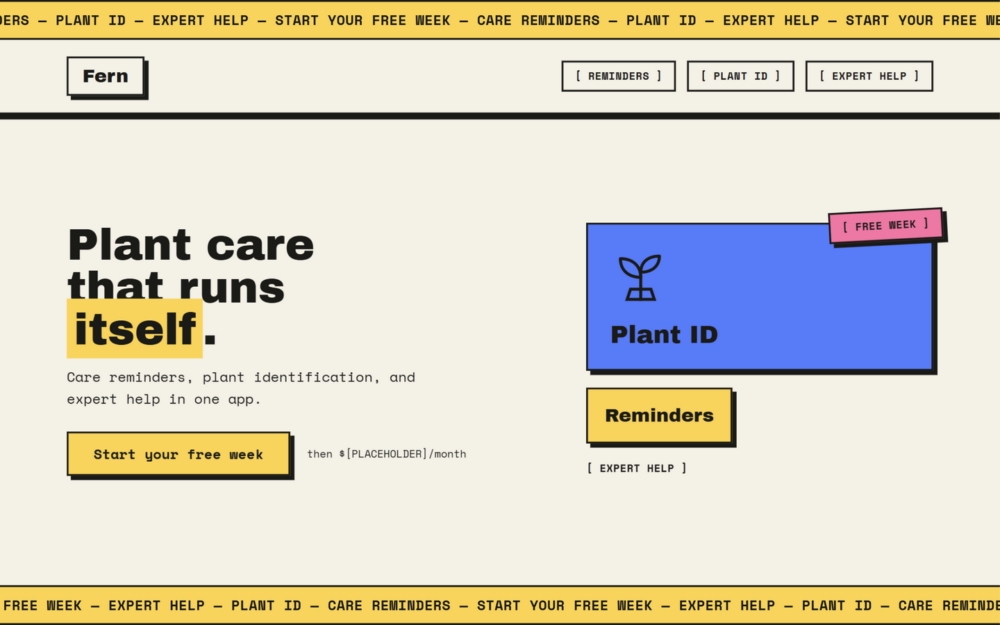
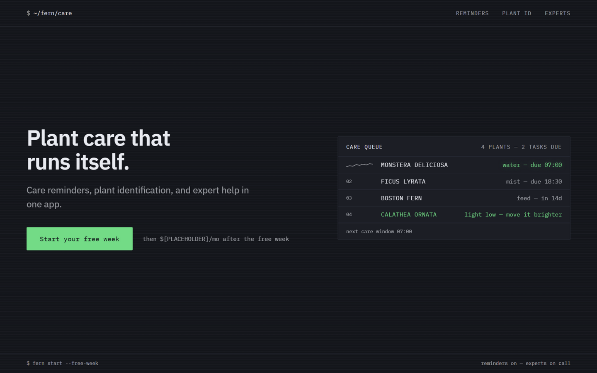
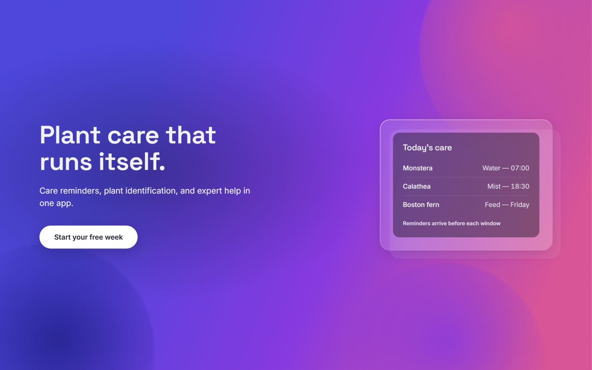
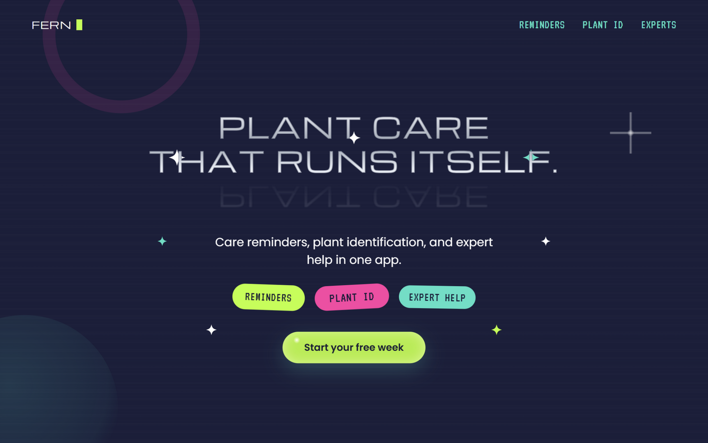
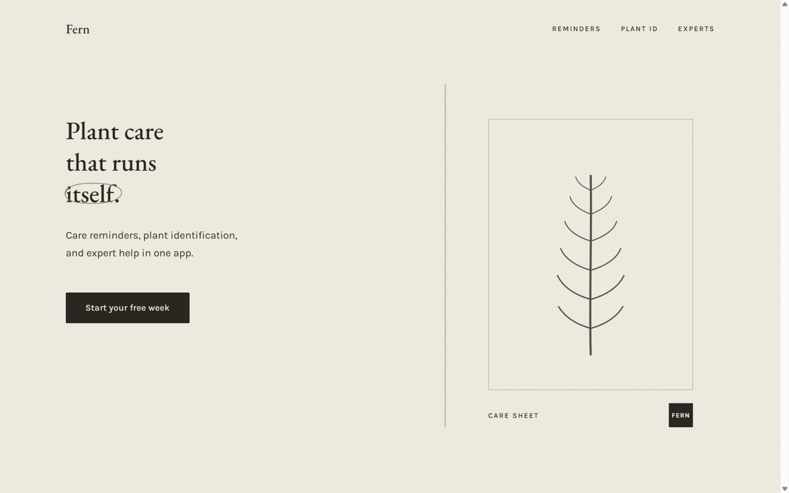

# Examples — grown by the garden itself

Every piece here was produced by **design-garden running its own workflow** (PARSE → ROUTE → BRIEF → DEAL → EXECUTE → GATE → DELIVER → LEARN) against the eval briefs in [`evals/tasks/`](../evals/tasks/). They are not hand-polished portfolio pieces — they are what the skill actually ships, including visible `[PLACEHOLDER]` markers where inventing facts would have been the slop move.

**Model attribution is part of the record.** Output quality comes from the model and the skill together, so every example states the model that produced it. Running the same brief on a different model? PR your result with the model named — cross-model results are exactly what the evals want to compare.

| Example | Eval brief | Model | Images | Source |
|---|---|---|---|---|
| Bike repair shop landing page | `ui-web-01` | **GLM-5.3-Flash** | [hero](images/bike-shop-hero.png) · [mobile 375px](images/bike-shop-mobile.png) · [full page](images/bike-shop-full.png) | [landing.html](bike-shop-landing/landing.html) |
| Jazz café opening poster (1080×1350) | `poster-banner-01` | **GLM-5.3-Flash** | [poster](images/jazz-poster.png) | [late-set-1080x1350.html](jazz-cafe-poster/late-set-1080x1350.html) |
| Jazz café poster — direction 2 "Cut Record" | `poster-banner-01` (the DEAL's dealt variant) | **GLM-5.3-Flash** | [poster](images/jazz-poster-cut-record.png) | [cut-record-1080x1350.html](jazz-cafe-poster/cut-record-1080x1350.html) |

The two jazz posters are the DEAL output in the flesh: same subject world (ink black, brass, cream), structurally different compositions (a void with one spotlight vs a cropped record where type is the image). See [case-studies/poster-dealing.md](../knowledge/case-studies/poster-dealing.md) for why directions must differ in structure, not palette.
| Plant-care app icon set (8 glyphs) | `icon-01` | **GLM-5.3-Flash** | [verification sheet](images/icon-sheet.png) | [icon-sheet.html](plant-icons/icon-sheet.html) + [svg/](plant-icons/svg/) |
| Social preview (1280×640) | repo promo | **GLM-5.3-Flash** | [preview](images/social-preview.png) | [preview-1280x640.html](social-preview/preview-1280x640.html) |
| Flower-shop anniversary poster (朋友圈 1080×1350) | independent QA run of the installed skill (fresh agent session) | **GLM-5.3-Flash** | [poster](images/flower-poster.png) | [poster.html](../selftest/flower-shop/poster.html) |

The flower poster is the first output from a **fresh agent session running the installed skill** — it dealt 3 directions (vertical market board / paper-cut wreath / seed-packet label), executed the wreath, and its GATE caught the SVG wreath falling off-canvas plus a broken type-scale chain before delivery. The visible `[店名]`/`[促销主打]` slots are the no-invented-facts rule in action.

## Style gallery — one brief, six styles

Same product ("Fern", plant-care subscription), same copy, six style recipes — **the only variable is the style system**. Built by a fresh agent run treating the recipes as authority; the run's recipe QA findings were folded back into the recipes themselves (see each file's `Field QA` section).

| | | |
|---|---|---|
|  |  |  |
| [swiss-international](styles/swiss-international.png) · [html](styles/swiss-international.html) | [neo-brutalism](styles/neo-brutalism.png) · [html](styles/neo-brutalism.html) | [dark-tech](styles/dark-tech.png) · [html](styles/dark-tech.html) |
|  |  |  |
| [glassmorphism](styles/glassmorphism.png) · [html](styles/glassmorphism.html) | [y2k-retro](styles/y2k-retro.png) · [html](styles/y2k-retro.html) | [japandi](styles/japandi.png) · [html](styles/japandi.html) |

Honest caption: glassmorphism's vivid gradient is the style's own signature (opted in by choosing the recipe) — outside a glassmorphism brief, that gradient sits on our Never list. Twelve more styles await rendering: claim them in [issue #2](https://github.com/iifzx/design-garden/issues/2).

## What the critique gate caught in these very outputs

Real fixes the GATE round made before delivery — evidence the quality loop works:

- **Landing**: brass text at 3.0:1 contrast demoted to borders; 4 font weights trimmed to 3; uniform section gaps re-rhythmed to 96/144; a static "Open today" claim (which would lie every Monday) replaced with real hour ranges; the mobile headline accent re-wrapped as a unit (`white-space: nowrap` on the span — `text-wrap: balance` alone was not enough).
- **Poster**: webfont link missing (would silently fall back to Georgia); the "where" line failed the squint test at 90% ink strength — smallest line kept its size, restored to full strength.
- **Icons**: gear glyph rejected for metaphor-density drift (sliders instead); 16px exports re-drawn with detail ladders rather than scaled.

Run `examples/*/…html` locally (or any static server) to inspect the source. Reuse them freely under the repo license.
